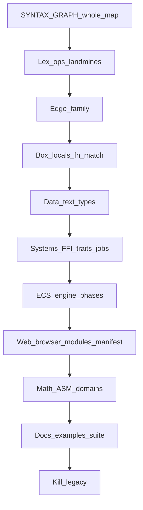

# Ouroboros graph dialect (SYNTAX_GRAPH)

Canonical writer-facing dialect: code should feel like wiring a visual node graph.
This document is the contract for the compiler, handbook, and suite. Dual-accept
legacy spellings until the kill-legacy pass; new code and docs use only the forms
marked **AFTER** below.

## Locked decisions

- **Identity:** writing Ouroboros = wiring a visual node graph in text (boxes, ports, edges, routers, schedule lanes).
- **Scope:** the **entire writer-facing language** in the handbook — not arrows alone. Every family below is either (1) **syntax change**, (2) **stdlib reframe** as namespaced node libraries with the new call/edge rules, or (3) **tooling-only** (CLI/editor) with diagnostics for the new dialect.
- **No abbreviation renames** (`float`/`f32` stay; no `fl`).
- **Compat:** dual-accept + deprecation warnings → migrate suite/docs → hard-remove via `OURO_GRAPH_STRICT=1`.
- **Locks:** `while` inside boxes (no `~[c]>`); ECS always `e in Group`; ranges **half-open under STRICT** (default inclusive until suite migrate); blocks need **`end`**; `outer` replaces `global`; `name: Type` only; abs/floor/ceil are **functions** outside `@Math`; `use` only (`include` dies); project **manifest**; node ports `in`/`out`; generics `fn Id[T](v)`; match is one **`match` router** (switch removed after migrate); logic `and`/`or`; `&`/`|` bitwise only.

## Implementation status

Shipped in-tree (dual-accept unless noted):

- New edges `|>` `||>` `||>>` `|?` `|!` `| when` `| match` `|=>` `|+>` `|->` `|> F from seed` `parallel …`
- Keywords `match` `outer` `from` `parallel` `when`; `**` power; `Id[T]` / `Pair[T]` / `Own[T]`
- `node … in[…] out[…]` with `name: Type` ports; namespaced builtins (`Http.Listen` → `HttpListen`, …)
- `ouroboros.project` manifest (see `docs/ouroboros.project.example`); `include` / ambient `each` / `[x]` abs warn (error under STRICT)
- Docs: What’s new graph section; decisions page points at this file; `tests/bug/cases/graph_dialect.ouro`
- **Suite migration (Wave 1):** `tests/bug/cases`, `examples`, `tests/check` migrated toward graph dialect. Chimera day-to-day gates use `compiler/fixtures` + `ouro-run-cases` / `ouro-fail-cases`. `.legacy_only` cases keep legacy spellings; `.strict_only` (`range_incl`) checks half-open ranges. Known gaps: `|>~` scan and seedless folds have no graph spelling; `Clone`/`ToMap`/`Pack`/`Unpack` on `Rec{}`; some examples still use `include`. Ambient `each` inside a function needs `outer Group_Field` once rewritten to binder form.

## Whole-language map (nothing silent)

Treatment key: **S** = syntax change · **N** = namespaced node library / call-shape only · **T** = tooling/diagnostics · **D** = docs reframe only this pass

- Start/tour/decisions handbook → **D** (become graph dialect; delete which-form matrix)
- Lexical structure → **S**
- Bindings & scope → **S**
- Values & types / conversions → **S**
- Operators & expressions → **S**
- Strings & text → **S** (+ **N** for Join/Split/… )
- Arrays & maps → **S** (+ **N** Push/Pop/… )
- Control flow → **S**
- Functions & calls → **S**
- Arrows & flows → **S**
- Nodes & `.nod` → **S**
- Errors & Fail → **S**
- Records & enums → **S**
- Modules & project files → **S**
- Math `@Math` / domains → **S**
- Console & file I/O → **N**
- Websites & HTTP / JSON / templates / WS / SQLite → **N**
- Browser / Dom / wasm handlers → **S** (handlers) + **N** (Dom*)
- Structs / pointers / slices / Buf / arenas → **S** (types) + **N** (Alloc…)
- Ownership Own/Rc → **S** (edges) + **N** (OwnNew…)
- FFI extern → **S** (block shape kept; foreign nodes)
- Generics & traits → **S**
- Threads / atomics / jobs → **N** short-term + job-graph docs; optional **S** `after` edges later in same overhaul after edges land
- ECS entities/components → **S**
- Engine lifecycle / Dt / play → **S** (phases) + **N** (Quit/SetFixedDt)
- Rendering / materials / textures / fonts / input / UI → **N** (`Rhi.*` / `Ui.*` framing)
- Audio / physics / PhysX → **N**
- Inline `@ASM` → **S** (canvas `end`)
- CLI / editor / performance / backends → **T** / **D** (not language syntax)
- Builtin API index → **N** (group by node library; same names dual, namespaced aliases added)

---

## Reference examples (contract)

### 0 — End-to-end (target)

```ouro
use "combat.nod"

mut input = ReadLine()
let code = input
    |> Parse
    |? LogErr
    |> Validate
    | when ok |> Save
    |! Notify

Nums ||> Double |> Print
let total = Nums |> Add from 0
Player ||>> Think

mut p = OwnNew(Vec3)
p |=> q
```

### 1 — Lexical & operators (**S**)

```ouro
# BEFORE
/* block ends the statement when it spans lines */
Y = [x]          # abs
Z = {x}          # floor
a >-1            # funnel digraph
c & d | e        # logic (also and/or/&&/||)
n ^ 2            # power (also XOR confusion)
x ?? 0
```

```ouro
# AFTER
/* nestable comments; do not terminate the surrounding statement */
let y = abs(x)
let z = floor(x)
let t = a |> Neg1
# or comparison: a > -1  (spaces; no >- token)
if c and d or e
end
let n2 = n ** 2      # power; ^ is bitwise XOR only
let x2 = x ?? 0      # keep nullish as expression op (not an edge)
```

### 2 — Binds, scope, types, conversions (**S**)

```ouro
# BEFORE
Speed := 10
Limit =: 100
mut Hits = 0
speed i32 := 5
pos f32
X -> u8
u8(X)
void Tick()
    global Hits
    Hits := + 1
end
```

```ouro
# AFTER
mut speed = 10
let limit = 100
mut hits = 0
mut speed: i32 = 5
mut pos: f32 = 0.0
let x2 = x |> to_u8
let x3 = to_u8(x)
void Tick()
    outer hits
    hits += 1
end
```

### 3 — Edges (**S**)

```ouro
# BEFORE
x -> Abs -> Print
a, b >- Max
Nums ~> Double
Nums, 0 >~ Add
Nums, 0 |>~ Add
Nums, 0 >>~ Add
Body ~>> Move
Parse(S) ?-> Log
Q -|> Double -> R
-[Ready]-> Fire
[Hp > 0] -> Heal()
Cmd -[ "go" -> 1 | -> 0 ]-> Code
First --> Second
Shared -+-> A, B
P -|-> Sink
```

```ouro
# AFTER
x |> Abs |> Print
a, b |> Max
Nums ||> Double
Nums |> Add from 0
parallel Nums |> Add from 0
Body ||>> Move
Parse(S) |? Log
Q |! Double |> R
Ready | when Ready |> Fire
Hp | when Hp > 0 |> Heal
Cmd | match
    "go" -> 1
    _    -> 0
end |> Code
First |=> Second
Shared |+> A, B
P |-> Sink
```

### 4 — Control inside a box (**S**)

```ouro
# BEFORE
if Ready
elseif Busy
else if Dead
elif Other
end
if (c) -> Call()
~[Count < 3]~> Count++
with Slot := FindId(E, 1)
    Use(Slot)
end
switch Cmd
    case "go", "run"
        Go()
    case 1 to 5
        Mid()
    case else
        Idle()
end
for I := 1 to 10 by 2
break Outer
```

```ouro
# AFTER
if Ready
elif Busy
elif Dead
elif Other
end
if c
    Call()
end
while count < 3
    count += 1
end
with slot = FindId(E, 1) when slot >= 0
    Use(slot)
end
match Cmd
    "go", "run" -> Go()
    1..6        -> Mid()    # half-open matches old 1 to 5 inclusive
    _           -> Idle()
end
for i = 1 to 10 by 2
end
break Outer
```

### 5 — Functions, calls, UFCS, Print (**S**)

```ouro
# BEFORE
fn Scale(V, F := 2)
    return V * F
end
void Bump(X)
    X = X + 1
end
a, b -> Print
Print(a, b)
recv.Method(1)
Arr -> Push(n)
Inv -> Has("k")
```

```ouro
# AFTER
fn Scale(v, f = 2)
    return v * f
end
void Bump(mut x)
    x = x + 1
end
a, b |> Print
Print(a, b)
recv.Method(1)       # sugar → Method(recv, 1)
Arr |> Push(n)       # or Push(Arr, n)
Inv |> Has("k")
```

### 6 — Strings & text (**S** + **N**)

```ouro
# BEFORE
Msg = "Hi $Name"
T = """
  line
"""
S[a..b]              # inclusive code-point slice
Join(Parts, ",")
```

```ouro
# AFTER
let msg = "Hi ${Name}"
let t = """
  line
"""
let s = S[a..b]      # half-open
Parts |> Join(",")   # or Join(Parts, ",")
```

### 7 — Arrays, maps, records, enums (**S**)

```ouro
# BEFORE
A = [1, 2]
B = [x,]             # singleton
Y = [x]              # abs — conflict
M = { gold: 10, "k": 1 }
Get(M, "k", 0)
record Hero
    Hp
end
H := Hero
H_Hp := 10
R = Hero{ Hp: 10 }
Clone(A, B)
Pack(H) / Unpack(M, H)
enum Color
    Red := 1
end
```

```ouro
# AFTER
let a = [1, 2]
let b = [x]          # one-element array (abs is abs(x))
let m = { gold: 10, "k": 1 }
Get(m, "k", 0)       # miss default stays a node
record Hero
    hp
end
# flat H := Hero expand REMOVED
let r = Hero{ hp: 10 }
Clone(a, b)
let m2 = Pack(r)
Unpack(m2, r)
enum Color
    Red = 1
end
match Color.Red
    Color.Red -> …
end
```

### 8 — Nodes & `.nod` (**S**)

```ouro
# BEFORE
node Damage In[H i32, A] Out[H, Dead]
    H - A -> Out.H
    0 -> Out.Dead
end
v -> Damage
```

```ouro
# AFTER
node Damage in[h: i32, a] out[h, dead]
    h - a |> out.h
    0 |> out.dead
end
v |> Damage
```

### 9 — Errors (**S**)

```ouro
# BEFORE
Fail("nope")
Parse(S) ?-> Log
"bad" -[n < 0]-> Fail
```

```ouro
# AFTER
Fail("nope")
Parse(S) |? Log
n | when n < 0 |> Fail("bad")
```

### 10 — Modules, project files, manifest (**S**)

```ouro
# BEFORE
include "util.ouro"
use "lib/"
use "x.var"
export A, B
# ../../foo.ent auto-loaded via 3-ancestor walk
```

```ouro
# AFTER
use "util.ouro"
use "lib/"
use "x.var"
export A, B

# ouroboros.project
# entities:
#   - foo.ent
# components:
#   - combat.com
# nodes:
#   - damage.nod
# domains:
#   - vec.dom
```

### 11 — `@Math`, `@ASM`, domains (**S**)

```ouro
# BEFORE
@Math
A := 2x^2 + Σ_{i=1}^{n} i + [x]
# indent may close
@ASM { mov rax, {Score} }
@Vec
U · V
```

```ouro
# AFTER
@Math
A := 2x^2 + Σ_{i=1}^{n} i + |x|
end
@ASM
mov rax, {Score}
end
@Vec
U · V
end
```

### 12 — Console & file I/O (**N**)

```ouro
# BEFORE / AFTER (same names; graph call shape)
line |> Print
Print(line)
let s = Read("save.txt")
Write("save.txt", s)
let b = ReadBin("x.bin")
WriteBin("x.bin", b)
let line2 = Input()
```

### 13 — Web / JSON / templates / WS / SQLite (**N**)

```ouro
# BEFORE (flat builtins)
HttpListen(8080)
ev = HttpAccept(srv)
HttpRespond(ev, 200, body)
ToJson(M)
FromJson(S)
RenderTemplate(t, M)
WsUpgrade(ev)
DbOpen("a.db")
DbQuery(db, sql)
```

```ouro
# AFTER (same ops; namespaced aliases preferred in new code)
Http.Listen(8080)
ev = Http.Accept(srv)
ev |> Http.Respond(200, body)
Json.Encode(M)
Json.Decode(S)
Template.Render(t, M)
ev |> Ws.Upgrade
db = Db.Open("a.db")
db |> Db.Query(sql)
# dual-accept bare HttpListen during migrate
```

### 14 — Browser / Dom (**S** + **N**)

```ouro
# BEFORE
void OnClick(N)
    DomSetText("out", "ok")
end
DomOn("btn", "click", OnClick)
```

```ouro
# AFTER
void OnClick(N)
    Dom.SetText("out", "ok")
end
Dom.On("btn", "click", OnClick)   # handler = graph entry node
```

### 15 — Structs, pointers, slices, Buf, arenas (**S** + **N**)

```ouro
# BEFORE
struct Vec3
    x f32
    y f32
    z f32
end
mut V: Vec3
mut P: *Vec3
P := &V
(*P).x := 1
S := MakeSlice(Raw, N)
B := MakeBuf(64)
A := ArenaNew(4096)
```

```ouro
# AFTER
struct Vec3
    x: f32
    y: f32
    z: f32
end
mut v: Vec3
mut p: *Vec3
p = &v
(*p).x = 1
let s = MakeSlice(Raw, N)
let b = MakeBuf(64)
let a = ArenaNew(4096)
# addresses stay C-like; never written as |> edges
```

### 16 — Ownership (**S** + **N**)

```ouro
# BEFORE
P := OwnNew(Vec3)
Q := P          # move on :=
R := RcNew(Vec3)
S := RcClone(R)
Drop(S)
First --> Second
```

```ouro
# AFTER
mut p = OwnNew(Vec3)
mut q = p |=> q_slot     # or: q = move(p)
mut r = RcNew(Vec3)
mut s = RcClone(r)
Drop(s)
First |=> Second
Shared |+> A, B
```

### 17 — FFI (**S**)

```ouro
# BEFORE
extern "libc.so.6", "msvcrt.dll"
fn strlen(S: CStr) -> u64
fn qsort(Base: *u8, N: u64, Size: u64, Cmp: fn(*u8, *u8) -> i32)
end
```

```ouro
# AFTER
extern "libc.so.6", "msvcrt.dll"
    fn strlen(s: CStr) -> u64
    fn qsort(base: *u8, n: u64, size: u64, cmp: fn(*u8, *u8) -> i32)
end
# foreign boxes; callbacks = nodes C calls back into
```

### 18 — Generics & traits (**S**)

```ouro
# BEFORE
struct Pair(T)
    A
    B
end
fn Id(T)(V)
    return V
end
trait Draw
    void Paint(Self)
end
impl Circle: Draw
    void Paint(Self)
    end
end
D := AsDyn(Draw, &C)
```

```ouro
# AFTER
struct Pair[T]
    a: T
    b: T
end
fn Id[T](v: T)
    return v
end
trait Draw
    void Paint(self)
end
impl Circle: Draw
    void Paint(self)
    end
end
let d = AsDyn(Draw, &c)    # dyn Draw = swappable node behind a port
```

### 19 — Concurrency (**N**, then light **S**)

```ouro
# BEFORE
t = SpawnThread(Worker)
JoinThread(t)
a = AtomicI64(0)
AtomicAdd(a, 1)
m = MutexNew()
MutexLock(m)
JobSubmit(q, Task)
h = JobSpawnAfter(g, Work, h1, h2)
```

```ouro
# AFTER (phase 1 — node library framing)
t = Thread.Spawn(Worker)
Thread.Join(t)
a = Atomic.I64(0)
Atomic.Add(a, 1)
m = Mutex.New()
Mutex.Lock(m)
q |> Job.Submit(Task)
# phase 2 (after edges): dependency edges
# Work ||> after h1, h2
```

### 20 — ECS & engine schedule (**S** + **N**)

```ouro
# BEFORE
entity Player
    Health
    X
end
component Combat
    Atk
end
entity Enemy
    uses Combat
end
each Player where Health > 0
    X = X + 1
end
Enemy@10
on Tick
    Player ~> Update
Body ~>> Move
Dt / Quit() / SetFixedDt(0.016)
```

```ouro
# AFTER
entity Player
    health
    x
end
component Combat
    atk
end
entity Enemy
    uses Combat
end
each e in Player where e.health > 0
    e.x = e.x + 1
end
FindId(Enemy, 10)     # Enemy@id sugar deprecated
on Tick
    Player ||> Update
end
Body ||>> Move
Player ||> Move when e.health > 0
# Dt, Time, FixedDt, Quit, SetFixedDt stay clock nodes
```

### 21 — Rendering / UI / input / audio / physics (**N**)

```ouro
# BEFORE
SetClearColor(0, 0, 0)
UploadMesh(0, Arr)
DrawMesh(0)
UiBegin()
if UiButton("Go")
end
UiEnd()
LoadSound(0, "a.wav")
PlaySound(0)
BodyBox(1, 1, 1, 1)
PhysStep(Dt)
```

```ouro
# AFTER (namespaced aliases; bare names dual during migrate)
Rhi.SetClearColor(0, 0, 0)
Rhi.UploadMesh(0, Arr)
Rhi.DrawMesh(0)
Ui.Begin()
if Ui.Button("Go")
end
Ui.End()
Audio.Load(0, "a.wav")
Audio.Play(0)
id = Phys.BodyBox(1, 1, 1, 1)
Phys.Step(Dt)
# still immediate-mode UI this pass — framed as widget nodes, not new syntax
```

### 22 — Tooling (**T** / **D**)

```text
# CLI unchanged in shape; diagnostics gain:
#   warning: `->` is deprecated; use `|>`
#   warning: `:=` is deprecated; use `mut name =`
#   warning: `include` is deprecated; use `use`
#   warning: ambient `each Player` is deprecated; use `each e in Player`
tools/ouro_run.bat main.ouro
# or: build/chimera main.ouro -o main.c && tools/ouro_link.bat main.c -o main.exe --out-dir build
```

---

## Work sequence



1. Spec file [`docs/SYNTAX_GRAPH.md`](docs/SYNTAX_GRAPH.md) mirrors every section above.
2. Lexer/operators/landmines → edges → box locals → data/text/types → systems/ownership/FFI/traits/jobs → ECS/engine → web/browser/modules/manifest → canvases → docs/suite → kill.

Primary touch points: [`ouroboros/lexer.py`](ouroboros/lexer.py), [`ouroboros/parser.py`](ouroboros/parser.py), bind/pipe/check/engine modules under [`ouroboros/`](ouroboros/), [`docs/content.js`](docs/content.js), [`docs/SYNTAX_GRAPH.md`](docs/SYNTAX_GRAPH.md), [`tests/`](tests/), [`examples/`](examples/), [`FEATURES.txt`](FEATURES.txt), [`NOTES.txt`](NOTES.txt), [`docs/USABILITY_NOTES.md`](docs/USABILITY_NOTES.md).

## Success bar

- Every handbook language page has a graph-dialect answer (syntax or node-library framing).
- ≤ ~8 edge roles + one inside-box dialect + namespaced stdlib groups.
- No everyday which-form matrix; no spacing digraph landmines.
- Suite and examples speak only the target dialect after kill pass.

## Non-goals

- GUI node editor.
- ADT payload enums / deep structural patterns.
- Renaming `float` → `fl` or similar.
- Replacing IMGUI with a declarative UI language.
- Rewriting backend architecture unrelated to syntax lowering.

